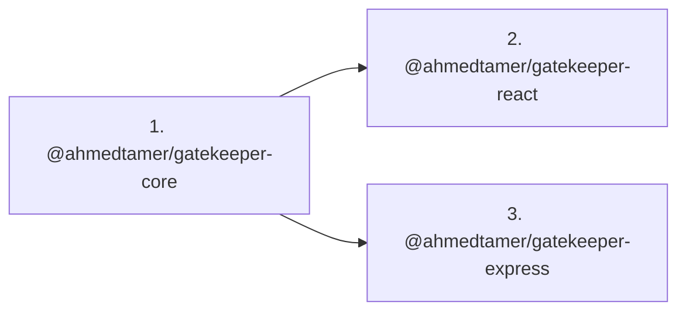

# Publishing Gatekeeper Packages to npm

This guide describes how to publish the three Gatekeeper library packages under the `@ahmedtamer` npm scope.

## Published Packages

| Package Directory  | npm Package Name                 | Version | Access |
| :----------------- | :------------------------------- | :------ | :----- |
| `packages/core`    | `@ahmedtamer/gatekeeper-core`    | `0.2.0` | Public |
| `packages/react`   | `@ahmedtamer/gatekeeper-react`   | `0.2.0` | Public |
| `packages/express` | `@ahmedtamer/gatekeeper-express` | `0.2.0` | Public |

> [!NOTE]
> The demo applications (`apps/demo-api` and `apps/demo-dashboard`) and the root monorepo are marked `"private": true` and are **never** published to npm.

---

## 1. Prerequisites & npm Authentication

1. Ensure you have an active npm account with permission to publish under `@ahmedtamer` (either as your personal account username or an npm organization).
2. Log in via your terminal:
   ```bash
   npm login
   ```
3. Confirm authentication:
   ```bash
   npm whoami
   # Output should display: ahmedtamer (or your authenticated npm user)
   ```

---

## 2. Check Package Name Availability

Verify that the target scoped package names are available:

```bash
npm view @ahmedtamer/gatekeeper-core version
npm view @ahmedtamer/gatekeeper-react version
npm view @ahmedtamer/gatekeeper-express version
```

- If an `E404 Not Found` error is returned, the package name is available and ready for first publish.
- If a version is returned, confirm you have owner/publish rights to that package.

---

## 3. Pre-Publish Validation (Lint, Test, Build)

Always run the full test suite and verification commands from the repository root (`G:\npm packages\gatekeeper`):

```bash
# 1. Format check
pnpm format

# 2. Strict linter (zero warnings)
pnpm lint

# 3. Vitest test suites (88+ tests)
pnpm test

# 4. Multi-package TypeScript & bundle build
pnpm build
```

---

## 4. Dry-Run Package Tarball Inspection

Before publishing live, inspect the generated package tarballs using dry-run to ensure only `dist/`, `README.md`, and `LICENSE` are included:

```bash
# Inspect core tarball
pnpm --filter @ahmedtamer/gatekeeper-core pack --dry-run

# Inspect react tarball
pnpm --filter @ahmedtamer/gatekeeper-react pack --dry-run

# Inspect express tarball
pnpm --filter @ahmedtamer/gatekeeper-express pack --dry-run
```

Verify that source files (`src/`), tests (`tests/`), and internal configs are **excluded** from the package contents.

---

## 5. Strict Publish Order

Because `@ahmedtamer/gatekeeper-react` and `@ahmedtamer/gatekeeper-express` depend on `@ahmedtamer/gatekeeper-core`, you **MUST** publish in this exact order:



### Exact Publish Commands

Run each publish command from the monorepo root:

```bash
# Step 1: Publish Core
pnpm --filter @ahmedtamer/gatekeeper-core publish --access public --no-git-checks

# Step 2: Publish React
pnpm --filter @ahmedtamer/gatekeeper-react publish --access public --no-git-checks

# Step 3: Publish Express
pnpm --filter @ahmedtamer/gatekeeper-express publish --access public --no-git-checks
```

> [!TIP]
> Each package has `"publishConfig": { "access": "public" }` and a `"prepack": "pnpm run build"` lifecycle hook configured in `package.json`, ensuring the TypeScript bundle is rebuilt right before packaging.

---

## 6. How to Publish a Patch or Minor Version Later

When releasing bug fixes or new features:

1. **Bump versions** across the packages:

   ```bash
   # Bump patch (0.1.0 -> 0.1.1)
   pnpm --filter @ahmedtamer/gatekeeper-core exec npm version patch
   pnpm --filter @ahmedtamer/gatekeeper-react exec npm version patch
   pnpm --filter @ahmedtamer/gatekeeper-express exec npm version patch

   # Or bump minor (0.1.0 -> 0.2.0)
   pnpm --filter @ahmedtamer/gatekeeper-core exec npm version minor
   pnpm --filter @ahmedtamer/gatekeeper-react exec npm version minor
   pnpm --filter @ahmedtamer/gatekeeper-express exec npm version minor
   ```

2. **Update dependency constraints** in `packages/react/package.json` and `packages/express/package.json` if core bumped to a new breaking or minor version:

   ```json
   "dependencies": {
     "@ahmedtamer/gatekeeper-core": "workspace:^0.2.0"
   }
   ```

3. **Re-run validation**:

   ```bash
   pnpm lint && pnpm test && pnpm build
   ```

4. **Publish in order**:
   ```bash
   pnpm --filter @ahmedtamer/gatekeeper-core publish --access public
   pnpm --filter @ahmedtamer/gatekeeper-react publish --access public
   pnpm --filter @ahmedtamer/gatekeeper-express publish --access public
   ```
