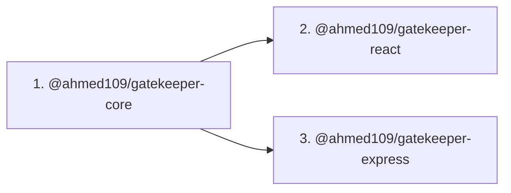

# Publishing Gatekeeper Packages to npm

This guide describes how to publish the three Gatekeeper library packages under the `@ahmed109` npm scope.

## Published Packages

| Package Directory  | npm Package Name               | Current Version | Access |
| :----------------- | :----------------------------- | :-------------- | :----- |
| `packages/core`    | `@ahmed109/gatekeeper-core`    | `0.3.0`         | Public |
| `packages/react`   | `@ahmed109/gatekeeper-react`   | `0.3.0`         | Public |
| `packages/express` | `@ahmed109/gatekeeper-express` | `0.3.0`         | Public |

> [!NOTE]
> The demo applications (`apps/demo-api` and `apps/demo-dashboard`) and the root monorepo are marked `"private": true` and are **never** published to npm.

---

## 1. Prerequisites & npm Authentication

1. Confirm you are logged in to your npm account:
   ```bash
   npm whoami
   # Output should display: ahmed109
   ```
2. If not logged in, authenticate in your terminal:
   ```bash
   npm login
   ```

---

## 2. Pre-Publish Validation (Lint, Test, Build)

Always run the full test suite and verification commands from the repository root:

```bash
# 1. Format check
pnpm format

# 2. Strict linter (zero warnings)
pnpm lint

# 3. Vitest test suites (107+ tests)
pnpm test

# 4. Multi-package TypeScript & bundle build
pnpm build
```

---

## 3. Dry-Run Package Tarball Inspection

Before publishing live, inspect the generated package tarballs using dry-run to ensure only `dist/`, `README.md`, and `LICENSE` are included:

```bash
# Single command from root
pnpm publish:dry-run
```

Or check each package individually:

```bash
pnpm --filter @ahmed109/gatekeeper-core pack --dry-run
pnpm --filter @ahmed109/gatekeeper-react pack --dry-run
pnpm --filter @ahmed109/gatekeeper-express pack --dry-run
```

Verify that source files (`src/`), tests (`tests/`), and internal configs are **excluded** from the package contents.

---

## 4. Strict Publish Order

Because `@ahmed109/gatekeeper-react` and `@ahmed109/gatekeeper-express` depend on `@ahmed109/gatekeeper-core`, you **MUST** publish in this exact order:



### Option A: Publish All in One Command

We configured a convenience script in root `package.json` that publishes all three packages in strict dependency order:

```bash
pnpm publish:packages
```

### Option B: Publish Manually Step-by-Step

```bash
# Step 1: Publish Core
pnpm --filter @ahmed109/gatekeeper-core publish --access public --no-git-checks

# Step 2: Publish React
pnpm --filter @ahmed109/gatekeeper-react publish --access public --no-git-checks

# Step 3: Publish Express
pnpm --filter @ahmed109/gatekeeper-express publish --access public --no-git-checks
```

> [!TIP]
> Each package has `"publishConfig": { "access": "public" }` and a `"prepack": "pnpm run build"` lifecycle hook configured in `package.json`, ensuring the TypeScript bundle is rebuilt right before packaging.

---

## 5. How to Publish a Patch or Minor Release

Because npm does not allow overwriting an already published version (e.g. `0.3.0`), increment the version number before publishing updates:

1. **Bump versions** across packages:

   ```bash
   # For a patch release (e.g. 0.3.0 -> 0.3.1):
   pnpm -r --filter "@ahmed109/*" exec npm version patch

   # Or for a minor release (e.g. 0.3.0 -> 0.4.0):
   pnpm -r --filter "@ahmed109/*" exec npm version minor
   ```

2. **Re-run validation**:

   ```bash
   pnpm lint && pnpm test && pnpm build
   ```

3. **Publish updated packages**:
   ```bash
   pnpm publish:packages
   ```
