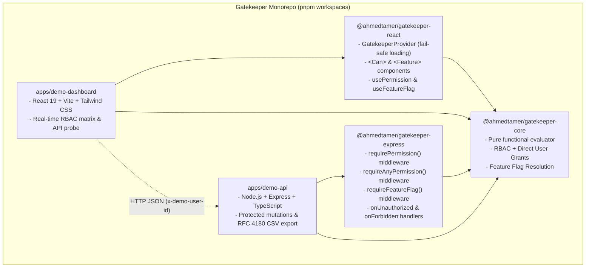

# 🛡️ Gatekeeper

> **Portfolio-quality, production-minded authorization and feature-flag toolkit for full-stack TypeScript applications.**

Gatekeeper provides declarative, type-safe permission checks and dynamic feature-flag evaluation across your entire stack. It pairs framework-independent core business logic with purpose-built packages for **React** frontends and **Express** backends.

---

> [!IMPORTANT]
> **Demonstration Architecture & Security Notice:**
>
> - **Simulated Authentication (`x-demo-user-id`)**: The included `demo-api` and `demo-dashboard` applications simulate authentication by passing an `x-demo-user-id` header to enable zero-friction role testing. **Never use header-based user impersonation in production.** Real applications should replace this middleware with signed JWT verification, secure session cookies, or an OAuth2/OIDC identity provider.
> - **In-Memory Volatile Store**: The demo API maintains state in memory for testing and experimentation. A real-world deployment requires database persistence (e.g., PostgreSQL with Prisma or Drizzle).
> - **OpenAPI / Swagger Contract**: The documentation served at `/api/docs` is currently maintained manually as a reference specification for the demo API rather than dynamically derived from route definitions.

---

## 🏗️ Architecture



---

## 📦 Packages Overview

| Package                                                | Status            | Description                                                                                 |
| :----------------------------------------------------- | :---------------- | :------------------------------------------------------------------------------------------ |
| [`@ahmedtamer/gatekeeper-core`](./packages/core)       | Portfolio-Quality | Framework-independent types, role-to-permission mappings, and pure `can()` evaluators.      |
| [`@ahmedtamer/gatekeeper-react`](./packages/react)     | Portfolio-Quality | React context provider, fail-safe loading state, `<Can>` / `<Feature>`, and reactive hooks. |
| [`@ahmedtamer/gatekeeper-express`](./packages/express) | Portfolio-Quality | Express route guards with customizable `onUnauthorized` and `onForbidden` callbacks.        |

---

## 🚀 Installation

### Frontend (React)

```bash
pnpm add @ahmedtamer/gatekeeper-core @ahmedtamer/gatekeeper-react
# or
npm install @ahmedtamer/gatekeeper-core @ahmedtamer/gatekeeper-react
```

### Backend (Express)

```bash
pnpm add @ahmedtamer/gatekeeper-core @ahmedtamer/gatekeeper-express
# or
npm install @ahmedtamer/gatekeeper-core @ahmedtamer/gatekeeper-express
```

---

---

## 💡 Identity Normalization & Adapters (v0.2)

Gatekeeper normalizes identity data into a standard `AuthorizationSubject` rather than forcing your application into a rigid database schema:

```typescript
type AuthorizationSubject = {
  id: string;
  role?: Role; // Legacy single-role support
  roles?: Role[]; // Preferred multiple-role support
  permissions?: Permission[]; // Explicit direct grants
  attributes?: Record<string, unknown>; // Optional metadata (tenantId, plan, teamId)
};
```

### Normalization Examples

#### 1. Simple Database User (`createSubject`)

```typescript
import { createSubject } from '@ahmedtamer/gatekeeper-core';

interface DbUser {
  user_id: string;
  primary_role: string;
  is_active: boolean;
}

const subject = createSubject(dbUser, {
  getId: (u) => u.user_id,
  getRoles: (u) => [u.primary_role],
  getAttributes: (u) => ({ isActive: u.is_active }),
});
```

#### 2. Keycloak / OIDC JWT Claims with Nested Roles (`fromJwtClaims`)

```typescript
import { fromJwtClaims } from '@ahmedtamer/gatekeeper-core';

// Automatically resolves 'sub', 'realm_access.roles', and custom claims
const jwtPayload = {
  sub: 'auth0|123456',
  realm_access: { roles: ['finance-admin', 'audit-viewer'] },
  email: 'finance@corp.local',
  tenant_id: 'ten_99',
};

const subject = fromJwtClaims(jwtPayload);
// subject.roles -> ['finance-admin', 'audit-viewer']
// subject.attributes -> { tenant_id: 'ten_99' }
```

#### 3. Custom Membership Model with Scoped Roles (`createSubject`)

```typescript
import { createSubject } from '@ahmedtamer/gatekeeper-core';

interface OrgMembership {
  memberId: string;
  organization: { id: string; name: string };
  accessTier: { roles: string[]; directGrants?: string[] };
}

const memberSubject = createSubject(membership, {
  getId: (m) => m.memberId,
  getRoles: (m) => m.accessTier.roles,
  getPermissions: (m) => m.accessTier.directGrants,
  getAttributes: (m) => ({ orgId: m.organization.id }),
});
```

---

## ⚖️ RBAC vs. Scoped / Policy-Based Authorization

Gatekeeper supports both static Role-Based Access Control and contextual, scoped policies:

- **RBAC**: Evaluates coarse-grained permissions granted by roles (`manager` -> `['reports.view']`).
- **Direct Grants**: Augments individual users with explicit permissions without role proliferation.
- **Scoped Policies**: Enables ownership, tenancy, and attribute checks via an `AuthorizationPolicy` callback:

```typescript
import { can, type AuthorizationPolicy } from '@ahmedtamer/gatekeeper-core';

// Policy returns boolean for immediate decision, or undefined to fall back to RBAC
const canEditDocument: AuthorizationPolicy = (subject, permission, context) => {
  if (permission === 'documents.update') {
    return context?.ownerId === subject.id; // Document owner check
  }
  return undefined; // Fall back to standard RBAC evaluation
};

const isAllowed = can(subject, 'documents.update', {
  policy: canEditDocument,
  context: { ownerId: 'usr_100' },
});
```

> [!WARNING]
> **Frontend UX vs. Backend Enforcement Security Notice:**
> Frontend checks with `@ahmedtamer/gatekeeper-react` (`<Can>`, `usePermission`) exist **solely to optimize user experience** by hiding irrelevant navigation and controls.
> **Backend authorization with `@ahmedtamer/gatekeeper-express` remains strictly mandatory.** Never rely on client-side checks for security boundaries.

---

## 💡 Usage Examples

### 1. React (`@ahmedtamer/gatekeeper-react`)

Wrap your application in `GatekeeperProvider` and use declarative components or hooks. During loading states (`isLoading = true`), all permission checks and feature flags fail safe (evaluated as `false`) to prevent flashes of unauthorized UI:

```tsx
import React from 'react';
import {
  GatekeeperProvider,
  Can,
  Feature,
  usePermission,
  useFeatureFlag,
} from '@ahmedtamer/gatekeeper-react';
import type { AuthorizationSubject } from '@ahmedtamer/gatekeeper-core';

const currentSubject: AuthorizationSubject = {
  id: 'usr_100',
  name: 'Alex Rivera',
  roles: ['manager', 'billing-manager'], // Multiple roles supported
  permissions: ['custom.audit'], // Optional direct permissions augmenting roles
  attributes: { tenantId: 'tenant_abc' },
};

const flags = {
  'new-dashboard': true,
  'export-reports': true,
  'beta-analytics': false,
};

export function App() {
  return (
    <GatekeeperProvider subject={currentSubject} flags={flags} isLoading={false}>
      <MainLayout />
    </GatekeeperProvider>
  );
}

function MainLayout() {
  const canReadUsers = usePermission('users.read');
  const hasBetaCharts = useFeatureFlag('beta-analytics');

  return (
    <div>
      <h1>Operations Hub</h1>

      {/* Conditionally render actions with <Can> */}
      <Can permission="users.delete" fallback={<p>Deletion requires Admin clearance.</p>}>
        <button onClick={() => deleteUser()}>Delete User Account</button>
      </Can>

      {/* Conditionally render features with <Feature> */}
      <Feature flag="export-reports">
        <button onClick={() => exportCsv()}>Export Reports as CSV</button>
      </Feature>

      {hasBetaCharts && <BetaAnalyticsChart />}
    </div>
  );
}
```

---

### 2. Express Backend (`@ahmedtamer/gatekeeper-express`)

Protect routes using declarative middleware. Missing authentication defaults to `401 Unauthorized`; insufficient privileges return `403 Forbidden`. You can also supply custom failure handlers:

```typescript
import express from 'express';
import {
  gatekeeperMiddleware,
  requirePermission,
  requireAnyPermission,
  requireFeatureFlag,
} from '@ahmedtamer/gatekeeper-express';
import type { GatekeeperUser } from '@ahmedtamer/gatekeeper-core';

const app = express();
app.use(express.json());

// 1. Authentication layer: Attach authenticated user to req.user
app.use((req, res, next) => {
  // In production, verify JWT bearer token or session cookie here
  req.user = authenticateRequest(req);
  req.gatekeeperFlags = { 'export-reports': true };
  next();
});

// 2. Global Gatekeeper middleware (supports global callbacks and helpers)
app.use(
  gatekeeperMiddleware({
    onUnauthorized: (res) => {
      res.status(401).json({ error: 'UNAUTHORIZED', message: 'Session expired or missing.' });
    },
    onForbidden: (res, missing) => {
      res.status(403).json({ error: 'FORBIDDEN', missingPermissions: missing });
    },
  }),
);

// 3. Protect routes with fine-grained permissions
app.get('/api/users', requirePermission('users.read'), (req, res) => {
  res.json({ users: [{ id: '1', name: 'Alice' }] });
});

// Admin-only route
app.delete('/api/users/:id', requirePermission('users.delete'), (req, res) => {
  res.json({ success: true, message: 'User deleted.' });
});

// Multiple permission check (any permission)
app.get('/api/reports', requireAnyPermission(['reports.view', 'admin.audit']), (req, res) => {
  res.json({ reports: [] });
});

// Route protected by both a permission AND a feature flag
app.get(
  '/api/reports/export',
  requirePermission('reports.view'),
  requireFeatureFlag('export-reports'),
  (req, res) => {
    res.attachment('reports.csv').send('id,title\r\n1,Audit\r\n');
  },
);

app.listen(3001);
```

---

## 🛠️ Demo Setup & Running Locally

Clone the monorepo and run:

```bash
# 1. Install all monorepo dependencies
pnpm install

# 2. Build all packages
pnpm build

# 3. Start both the Demo API and Demo Dashboard concurrently
pnpm dev
```

- **Demo Dashboard**: [http://localhost:5173](http://localhost:5173)
  - Features real-time role switching (**Admin**, **Manager**, **Member**, and **Unauthenticated**).
  - Live interactive permission matrix table.
  - Interactive feature flag toggles.
  - Live HTTP API probe executing actual network calls against the backend with latency tracking and status inspection (200, 401, 403).
- **Demo API**: [http://localhost:3001](http://localhost:3001)
- **OpenAPI / Swagger Documentation**: [http://localhost:3001/api/docs](http://localhost:3001/api/docs)

---

## 📋 API Endpoints Reference

The `demo-api` implements these endpoints:

| Endpoint                         |  Method  | Required Permission | Required Feature Flag | Behavior & Scope                                               |
| :------------------------------- | :------: | :------------------ | :-------------------- | :------------------------------------------------------------- |
| `/api/me`                        |  `GET`   | Authenticated       | None                  | Returns active user profile, effective permissions, and flags. |
| `/api/feature-flags`             |  `GET`   | Public              | None                  | Lists all system feature flags.                                |
| `/api/feature-flags/:key/toggle` |  `POST`  | `settings.manage`   | None                  | **Protected**: Toggles a feature flag (Admin clearance).       |
| `/api/reset`                     |  `POST`  | `settings.manage`   | None                  | **Protected**: Resets in-memory demo data (Admin clearance).   |
| `/api/reports`                   |  `GET`   | `reports.view`      | None                  | Lists compliance and security audit reports.                   |
| `/api/reports/export`            |  `GET`   | `reports.view`      | `export-reports`      | Streams RFC 4180 escaped CSV download of audit reports.        |
| `/api/users`                     |  `GET`   | `users.read`        | None                  | Lists system user accounts (Admin & Manager).                  |
| `/api/users/:id`                 | `DELETE` | `users.delete`      | None                  | Deletes user record (Admin only).                              |
| `/api/settings`                  |  `GET`   | `settings.manage`   | None                  | Retrieves tenant security configurations (Admin only).         |
| `/api/docs`                      |  `GET`   | Public              | None                  | Swagger UI API explorer (reference specification).             |

---

## 🧪 Testing

Gatekeeper features comprehensive test coverage using **Vitest** for core logic, **React Testing Library** for frontend components/loading states, and **Supertest** for Express middleware and API routes.

Run the test suites across all packages:

```bash
# Run all unit and integration tests
pnpm test

# Run tests in specific packages
pnpm --filter @ahmedtamer/gatekeeper-core test
pnpm --filter @ahmedtamer/gatekeeper-react test
pnpm --filter @ahmedtamer/gatekeeper-express test
pnpm --filter demo-api test

# Type checking and linting
pnpm lint
pnpm format
```

### Verified Test Cases:

- ✅ **Admin Access**: Full access confirmed across user management, reports, settings, and mutation endpoints.
- ✅ **Manager Access**: Access granted for `users.read` and `reports.view`; strictly denied (403) for deletions, settings, and mutations.
- ✅ **Member Denial**: Strict denial (403) for administrative and management operations.
- ✅ **Direct Permissions**: Direct user grants combine cleanly with role policies.
- ✅ **Missing Authenticated User**: Clean HTTP 401 response when auth context is absent.
- ✅ **Custom Middleware Callbacks**: Verifies custom `onUnauthorized`, `onForbidden`, `getUser`, and `getFlags` execution.
- ✅ **Protected Mutations**: Verifies `/api/feature-flags/:key/toggle` and `/api/reset` require `settings.manage` (401 unauthenticated, 403 manager/member, 200 admin).
- ✅ **RFC 4180 CSV Escaping**: Validates proper escaping for double quotes (`""`), commas, line breaks (`\n` and `\r\n`), and special characters.
- ✅ **Fail-Safe Loading**: Confirms `<Feature>` and `useFeatureFlag` fail safe during `isLoading` without leaking enabled content.

---

## 🗺️ Future Roadmap

Gatekeeper is architected with clean dependency injection and functional boundaries to enable future expansions:

1. **PostgreSQL Persistence Layer**:
   - Store roles, permissions, user memberships, and flag rules in relational tables using Prisma or Drizzle ORM.
2. **JWT & Session Integration**:
   - Built-in strategy to decode and verify JWT claims directly into `GatekeeperUser` instances.
3. **Structured Audit Logging**:
   - Interceptors emitting cryptographic audit trails for all authorization decisions to SIEM systems (OpenTelemetry, Datadog).
4. **Auto-Generated OpenAPI Contracts**:
   - Derive OpenAPI specifications directly from TypeScript route schemas (via Zod or tsoa).
5. **Multi-Tenancy & Hierarchical Organizations**:
   - Scoped permissions such as `org:123/projects.create` and inherited organizational permission trees.
6. **NPM Publishing Pipeline**:
   - Automated semantic versioning and publishing to NPM via Changesets and GitHub Actions.

---

## 📄 License

MIT © 2026 Gatekeeper Contributors.
