# 🛡️ Gatekeeper

> **Production-grade authorization and feature-flag toolkit for full-stack TypeScript applications.**

Gatekeeper provides declarative, type-safe permission checks and dynamic feature-flag evaluation across your entire stack. It pairs framework-independent core business logic with purpose-built packages for **React** frontends and **Express** backends.

---

## 🏗️ Architecture

```mermaid
graph TD
    subgraph Monorepo ["Gatekeeper Monorepo (pnpm workspaces)"]
        Core["@gatekeeper/core<br/>- Pure functional evaluator<br/>- RBAC + Direct User Grants<br/>- Feature Flag Resolution"]
        ReactPkg["@gatekeeper/react<br/>- GatekeeperProvider<br/>- &lt;Can&gt; & &lt;Feature&gt; components<br/>- usePermission & useFeatureFlag"]
        ExpressPkg["@gatekeeper/express<br/>- requirePermission() middleware<br/>- requireAnyPermission() middleware<br/>- requireFeatureFlag() middleware<br/>- req.user type augmentation"]
        DemoDashboard["apps/demo-dashboard<br/>- React 19 + Vite + Tailwind CSS<br/>- Real-time RBAC matrix & API probe"]
        DemoApi["apps/demo-api<br/>- Node.js + Express + TypeScript<br/>- OpenAPI Swagger documentation"]
    end

    ReactPkg --> Core
    ExpressPkg --> Core
    DemoDashboard --> ReactPkg
    DemoDashboard --> Core
    DemoApi --> ExpressPkg
    DemoApi --> Core
    DemoDashboard -. "HTTP JSON (x-demo-user-id)" .-> DemoApi
```



---

## 📦 Packages Overview

| Package                                     | Status           | Description                                                                                |
| :------------------------------------------ | :--------------- | :----------------------------------------------------------------------------------------- |
| [`@gatekeeper/core`](./packages/core)       | Production Ready | Framework-independent types, role-to-permission mappings, and pure `can()` evaluators.     |
| [`@gatekeeper/react`](./packages/react)     | Production Ready | React context provider, declarative `<Can>` / `<Feature>` guards, and reactive hooks.      |
| [`@gatekeeper/express`](./packages/express) | Production Ready | Robust Express route guards enforcing permissions and feature flags with 401/403 payloads. |

---

## 🚀 Installation

### Frontend (React)

```bash
pnpm add @gatekeeper/core @gatekeeper/react
# or
npm install @gatekeeper/core @gatekeeper/react
```

### Backend (Express)

```bash
pnpm add @gatekeeper/core @gatekeeper/express
# or
npm install @gatekeeper/core @gatekeeper/express
```

---

## 💡 Usage Examples

### 1. React (`@gatekeeper/react`)

Wrap your application in `GatekeeperProvider` and use declarative components or hooks:

```tsx
import React from 'react';
import { GatekeeperProvider, Can, Feature, usePermission, useFeatureFlag } from '@gatekeeper/react';
import type { GatekeeperUser } from '@gatekeeper/core';

const currentUser: GatekeeperUser = {
  id: 'usr_100',
  name: 'Alex Rivera',
  role: 'manager', // permissions: ['users.read', 'reports.view']
  permissions: ['custom.audit'], // optional direct permissions
};

const flags = {
  'new-dashboard': true,
  'export-reports': true,
  'beta-analytics': false,
};

export function App() {
  return (
    <GatekeeperProvider user={currentUser} flags={flags}>
      <MainLayout />
    </GatekeeperProvider>
  );
}

function MainLayout() {
  const canReadUsers = usePermission('users.read');
  const hasBetaCharts = useFeatureFlag('beta-analytics');

  return (
    <div>
      <h1>Operations Hub</h1>

      {/* Conditionally render actions with <Can> */}
      <Can permission="users.delete" fallback={<p>Deletion requires Admin clearance.</p>}>
        <button onClick={() => deleteUser()}>Delete User Account</button>
      </Can>

      {/* Conditionally render features with <Feature> */}
      <Feature flag="export-reports">
        <button onClick={() => exportCsv()}>Export Reports as CSV</button>
      </Feature>

      {hasBetaCharts && <BetaAnalyticsChart />}
    </div>
  );
}
```

---

### 2. Express Backend (`@gatekeeper/express`)

Protect routes using declarative middleware. Missing authentication returns `401 Unauthorized`; insufficient privileges return `403 Forbidden`.

```typescript
import express from 'express';
import {
  gatekeeperMiddleware,
  requirePermission,
  requireAnyPermission,
  requireFeatureFlag,
} from '@gatekeeper/express';
import type { GatekeeperUser } from '@gatekeeper/core';

const app = express();
app.use(express.json());

// 1. Authentication layer: Attach authenticated user to req.user
app.use((req, res, next) => {
  // Replace with your real JWT/Session validation
  req.user = authenticateRequest(req);
  req.gatekeeperFlags = { 'export-reports': true };
  next();
});

// 2. Attach Gatekeeper helpers (req.can)
app.use(gatekeeperMiddleware());

// 3. Protect routes with fine-grained permissions
app.get('/api/users', requirePermission('users.read'), (req, res) => {
  res.json({ users: [{ id: '1', name: 'Alice' }] });
});

// Admin-only route
app.delete('/api/users/:id', requirePermission('users.delete'), (req, res) => {
  res.json({ success: true, message: 'User deleted.' });
});

// Route protected by multiple permissions
app.get('/api/reports', requireAnyPermission(['reports.view', 'admin.audit']), (req, res) => {
  res.json({ reports: [] });
});

// Route protected by both a permission AND a feature flag
app.get(
  '/api/reports/export',
  requirePermission('reports.view'),
  requireFeatureFlag('export-reports'),
  (req, res) => {
    res.attachment('reports.csv').send('id,title\n1,Audit');
  },
);

app.listen(3001);
```

---

## 🛠️ Demo Setup & Running Locally

Clone the monorepo and run:

```bash
# 1. Install all monorepo dependencies
pnpm install

# 2. Build all packages
pnpm build

# 3. Start both the Demo API and Demo Dashboard concurrently
pnpm dev
```

- **Demo Dashboard**: [http://localhost:5173](http://localhost:5173)
  - Features real-time role switching (**Admin**, **Manager**, **Member**, and **Unauthenticated**).
  - Live interactive permission matrix table.
  - Interactive feature flag toggles.
  - Live HTTP API probe executing actual network calls against the backend with latency tracking and status inspection (200, 401, 403).
- **Demo API**: [http://localhost:3001](http://localhost:3001)
- **OpenAPI / Swagger Documentation**: [http://localhost:3001/api/docs](http://localhost:3001/api/docs)

---

## 📋 API Endpoints Reference

The `demo-api` implements these protected endpoints:

| Endpoint                         |  Method  | Required Permission | Required Feature Flag | Default Behavior                                               |
| :------------------------------- | :------: | :------------------ | :-------------------- | :------------------------------------------------------------- |
| `/api/me`                        |  `GET`   | Authenticated       | None                  | Returns active user profile, effective permissions, and flags. |
| `/api/feature-flags`             |  `GET`   | Public              | None                  | Lists all system feature flags.                                |
| `/api/feature-flags/:key/toggle` |  `POST`  | Public              | None                  | Toggles a feature flag for live experimentation.               |
| `/api/reports`                   |  `GET`   | `reports.view`      | None                  | Lists compliance and security audit reports.                   |
| `/api/reports/export`            |  `GET`   | `reports.view`      | `export-reports`      | Streams CSV download of audit reports.                         |
| `/api/users`                     |  `GET`   | `users.read`        | None                  | Lists system user accounts (Admin & Manager).                  |
| `/api/users/:id`                 | `DELETE` | `users.delete`      | None                  | Deletes user record (Admin only).                              |
| `/api/settings`                  |  `GET`   | `settings.manage`   | None                  | Retrieves tenant security configurations (Admin only).         |
| `/api/docs`                      |  `GET`   | Public              | None                  | Interactive Swagger UI API documentation.                      |

---

## 🧪 Testing

Gatekeeper features full test coverage using **Vitest** for core logic, **React Testing Library** for frontend hooks and components, and **Supertest** for Express middleware.

Run the test suites across all packages:

```bash
# Run all unit and integration tests
pnpm test

# Run tests in specific packages
pnpm --filter @gatekeeper/core test
pnpm --filter @gatekeeper/react test
pnpm --filter @gatekeeper/express test
pnpm --filter demo-api test

# Type checking and linting
pnpm lint
pnpm format
```

### Verified Test Cases:

- ✅ **Admin Access**: Verifies full access to user management, reports, and tenant settings.
- ✅ **Manager Access**: Verifies granted access to users.read and reports.view, and denial for users.delete and settings.manage.
- ✅ **Member Denial**: Verifies strict denial (403) for administrative and management operations.
- ✅ **Direct Permissions**: Verifies direct user grants combine cleanly with role policies without race conditions.
- ✅ **Missing Authenticated User**: Verifies clean HTTP 401 response when `req.user` or auth context is absent.
- ✅ **Disabled Feature Flags**: Verifies that routes and UI components correctly deny or hide disabled features.

---

## 🗺️ Future Roadmap

Gatekeeper is architected with clean dependency injection and functional boundaries to enable future expansions without breaking changes:

1. **PostgreSQL Persistence Layer**:
   - Store roles, permissions, user memberships, and flag rules in relational tables using Prisma or Drizzle ORM.
2. **JWT & Session Integration**:
   - Built-in strategy to decode and verify JWT claims directly into `GatekeeperUser` instances.
3. **Structured Audit Logging**:
   - Interceptors emitting cryptographic audit trails for all authorization decisions to SIEM systems (OpenTelemetry, Datadog).
4. **Multi-Tenancy & Hierarchical Organizations**:
   - Scoped permissions such as `org:123/projects.create` and inherited organizational permission trees.
5. **NPM Publishing Pipeline**:
   - Automated semantic versioning and publishing to NPM via Changesets and GitHub Actions.

---

## 📄 License

MIT © 2026 Gatekeeper Contributors.
