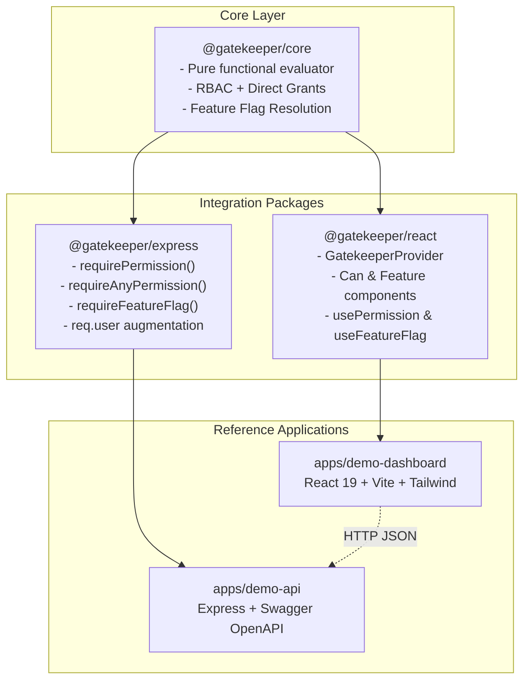
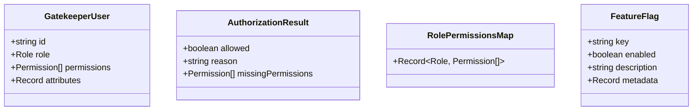

# Gatekeeper Architecture & Technical Design

## 1. Overview & Philosophy

**Gatekeeper** is a unified, framework-agnostic authorization and feature-flag platform for full-stack TypeScript architectures. The toolkit decouples business permission decisions from transport mechanisms (REST, GraphQL, gRPC) and presentation layers (React, CLI, mobile).



---

## 2. Core Concepts

### Pure Authorization Function (`can`)

The evaluator function in `@gatekeeper/core` is a deterministic, side-effect free function:

```typescript
function can(
  user: GatekeeperUser | null | undefined,
  permission: Permission,
  roleMap?: RolePermissionsMap,
): boolean;
```

1. **Null-Safety**: When `user` is `null` or `undefined`, `can` returns `false` without throwing runtime exceptions.
2. **Layered Privilege Model**:
   - **Role-Based Access Control (RBAC)**: Roles map to granted permission arrays (e.g. `admin`, `manager`, `member`).
   - **Direct Grants (ABAC / Explicit Assignment)**: Individual users can be granted specific direct permissions (`user.permissions`) that supersede or expand role boundaries without requiring custom role creation.
3. **Compound Queries**:
   - `canAll(user, permissions)`: User must possess every permission in the list.
   - `canAny(user, permissions)`: User must possess at least one of the listed permissions.

---

## 3. Package Structure

### `@gatekeeper/core`

- **Zero runtime dependencies**: Extremely fast and lightweight.
- **Framework independent**: Operates in browsers, Node.js, Cloudflare Workers, Deno, Bun, and React Native.
- **Strict typing**: Fully typed permissions and roles with open-ended extension through string literal unions.

### `@gatekeeper/react`

- **Context-driven caching**: Memoizes effective permission sets to minimize evaluation overhead during re-renders.
- **Component Primitives**:
  - `<Can permission="users.delete" fallback={<Denied />}>`: Declarative permission guard.
  - `<Feature flag="beta-analytics" fallback={<Fallback />}>`: Declarative feature flag guard.
- **Hooks**:
  - `usePermission(perm)`: Returns boolean permission state.
  - `useFeatureFlag(key)`: Returns boolean flag state.
  - `useGatekeeper()`: Accesses complete context including `user`, `flags`, and `can`.

### `@gatekeeper/express`

- **Declarative Middleware**:
  - `requirePermission('users.read')`: Enforces required permission, returning HTTP 401 when unauthenticated and HTTP 403 when forbidden.
  - `requireAnyPermission(['users.read', 'reports.view'])`: Enforces presence of at least one permission.
  - `requireFeatureFlag('export-reports')`: Rejects requests with HTTP 403 when a system feature flag is disabled.
- **Type Augmentation**: Safely extends Express `Request` with `req.user`, `req.gatekeeperFlags`, and `req.can`.

---

## 4. Extensibility & Future Architecture

Gatekeeper is intentionally engineered to allow seamless addition of enterprise features without breaking core signatures:



1. **PostgreSQL Adapter**: The pure evaluator can be wrapped by an adapter reading permissions and user records from SQL tables.
2. **JWT Integration**: Tokens containing role claims and permissions can directly hydrate `req.user`.
3. **Audit Logging**: The detailed `evaluatePermission()` diagnostic results can be streamed directly into OpenTelemetry or Kafka.
