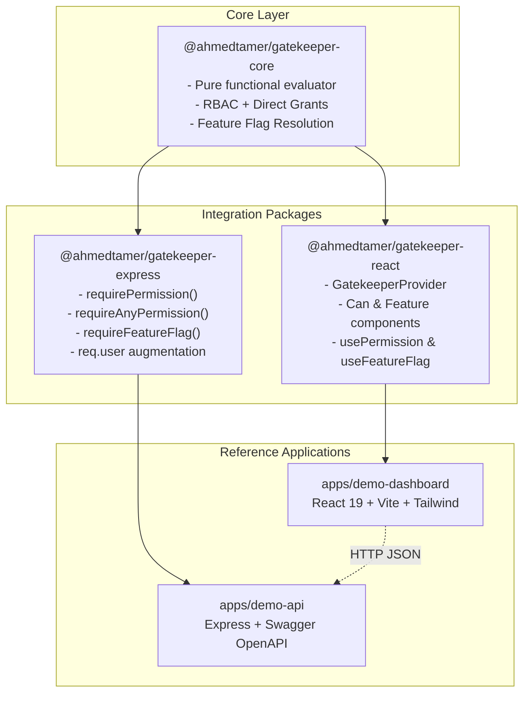
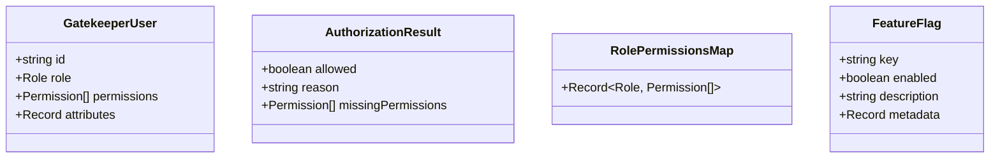

# Gatekeeper Architecture & Technical Design

## 1. Overview & Philosophy

**Gatekeeper** is a unified, framework-agnostic authorization and feature-flag platform for full-stack TypeScript architectures. The toolkit decouples business permission decisions from transport mechanisms (REST, GraphQL, gRPC) and presentation layers (React, CLI, mobile).



---

## 2. Core Concepts

### Pure Authorization Function (`can`)

The evaluator function in `@ahmedtamer/gatekeeper-core` is a deterministic, side-effect free function:

```typescript
function can(
  user: GatekeeperUser | null | undefined,
  permission: Permission,
  roleMap?: RolePermissionsMap,
): boolean;
```

1. **Null-Safety**: When `user` is `null` or `undefined`, `can` returns `false` without throwing runtime exceptions.
2. **Layered Privilege Model**:
   - **Role-Based Access Control (RBAC)**: Roles map to granted permission arrays (e.g. `admin`, `manager`, `member`).
   - **Direct Grants (ABAC / Explicit Assignment)**: Individual users can be granted specific direct permissions (`user.permissions`) that supersede or expand role boundaries without requiring custom role creation.
3. **Compound Queries**:
   - `canAll(user, permissions)`: User must possess every permission in the list.
   - `canAny(user, permissions)`: User must possess at least one of the listed permissions.

---

## 3. Package Structure

### `@ahmedtamer/gatekeeper-core`

- **Zero runtime dependencies**: Extremely fast and lightweight.
- **Framework independent**: Operates in browsers, Node.js, Cloudflare Workers, Deno, Bun, and React Native.
- **Strict typing**: Fully typed permissions and roles with open-ended extension through string literal unions.

### `@ahmedtamer/gatekeeper-react`

- **Context-driven caching**: Memoizes effective permission sets to minimize evaluation overhead during re-renders.
- **Component Primitives**:
  - `<Can permission="users.delete" fallback={<Denied />}>`: Declarative permission guard.
  - `<Feature flag="beta-analytics" fallback={<Fallback />}>`: Declarative feature flag guard.
- **Hooks**:
  - `usePermission(perm)`: Returns boolean permission state.
  - `useFeatureFlag(key)`: Returns boolean flag state.
  - `useGatekeeper()`: Accesses complete context including `user`, `flags`, and `can`.

### `@ahmedtamer/gatekeeper-express`

- **Declarative Middleware**:
  - `requirePermission('users.read')`: Enforces required permission, returning HTTP 401 when unauthenticated and HTTP 403 when forbidden.
  - `requireAnyPermission(['users.read', 'reports.view'])`: Enforces presence of at least one permission.
  - `requireFeatureFlag('export-reports')`: Rejects requests with HTTP 403 when a system feature flag is disabled.
- **Customizable Auth Callbacks**:
  - `onUnauthorized(req, res)`: Custom handler called when no authenticated user is present. If omitted, falls back to `{ error: 'Unauthorized', message: 'Authentication required' }` (401).
  - `onForbidden(req, res, missingPermissions)`: Custom handler called when the authenticated user lacks the required permission(s). If omitted, falls back to `{ error: 'Forbidden', message: 'Insufficient permissions', missingPermissions }` (403).
  - Configurable at both the global middleware level (`gatekeeper(...)`) and overridden per-route (`requirePermission(perm, { onForbidden, onUnauthorized })`).
- **Context Resolution**:
  - Dynamically resolves user identity (`getUser`) and feature flags (`getFlags`) from route options, request-level augmentation (`req.user`), or global middleware options.
- **Type Augmentation**: Safely extends Express `Request` with `req.user`, `req.gatekeeperFlags`, `req.can`, and `req.gatekeeperOptions`.

---

## 4. Security & Safety Design

### Fail-Safe React Loading State

In `@ahmedtamer/gatekeeper-react`, authorization decisions default to closed (`deny`):

- While `isLoading: true`, `isFeatureEnabled()`, `can()`, `canAll()`, and `canAny()` unconditionally evaluate to `false`.
- Guard components (`<Can>` and `<Feature>`) render their respective `fallback` slots (or `null`) until loading completes.
- Prevents UI flashes of privileged actions or sensitive controls during asynchronous authentication / profile hydration.

### RFC 4180 Compliant CSV Export

In `apps/demo-api`, the report export utility (`csv.ts`) enforces RFC 4180 standard formatting:

- Fields containing double quotes (`"`), commas (`,`), carriage returns (`\r`), newlines (`\n`), or leading/trailing whitespace are quoted.
- Double quotes inside values are properly escaped by doubling them (`""`).
- Line endings default to standard CRLF (`\r\n`).

### Demonstration vs. Production Architecture

| Concern                   | Demo Implementation (`apps/demo-api`)                  | Production Recommendation                                                       |
| :------------------------ | :----------------------------------------------------- | :------------------------------------------------------------------------------ |
| **Authentication**        | `x-demo-user-id` header mapped to in-memory mock users | JWT / OIDC session verification middleware (OAuth2, Auth0, Supabase, Clerk)     |
| **Persistence**           | Volatile in-memory mock data with `POST /api/reset`    | PostgreSQL / DynamoDB with ACID transactions and schema migrations              |
| **State Synchronization** | Manual polling or page refresh                         | WebSockets, Server-Sent Events (SSE), or cache invalidation (React Query / SWR) |
| **Feature Flags**         | In-memory key-value map with `POST /toggle`            | Unleash, LaunchDarkly, or Redis with targeting rules and percentage rollouts    |
| **API Documentation**     | Handcrafted OpenAPI 3.0 specification (`swagger.ts`)   | Auto-generated specs from Zod / tsoa / NestJS decorators with CI validation     |
| **Rate Limiting & CORS**  | Basic local CORS for demo dashboard                    | Reverse-proxy rate limiting (Cloudflare, Envoy), Redis-backed token buckets     |

---

## 5. Extensibility & Future Architecture

Gatekeeper is intentionally engineered to allow seamless addition of enterprise features without breaking core signatures:



1. **Database-Backed Evaluator**: The pure evaluator can be wrapped by an adapter reading permissions, role inheritance graphs, and user records from SQL tables.
2. **JWT Claims Hydration**: Cryptographically signed tokens containing role claims and permissions can directly hydrate `req.user` in an upstream authentication middleware.
3. **Structured Audit Logging**: The detailed `evaluatePermission()` diagnostic results can be piped directly into OpenTelemetry, Datadog, or Kafka for compliance tracing.
